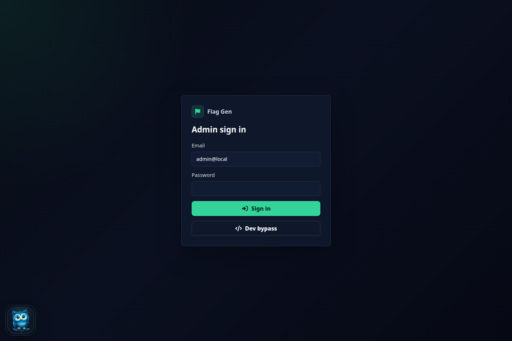
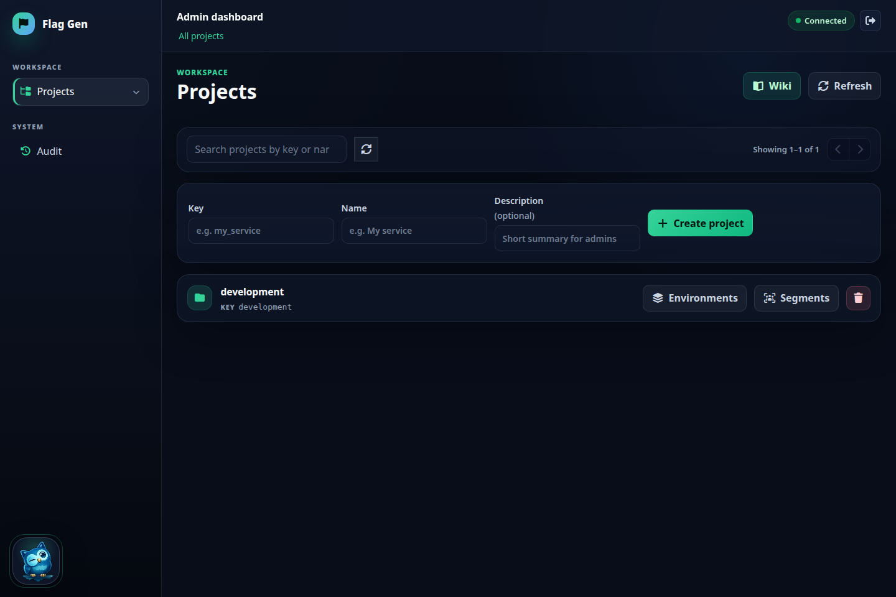
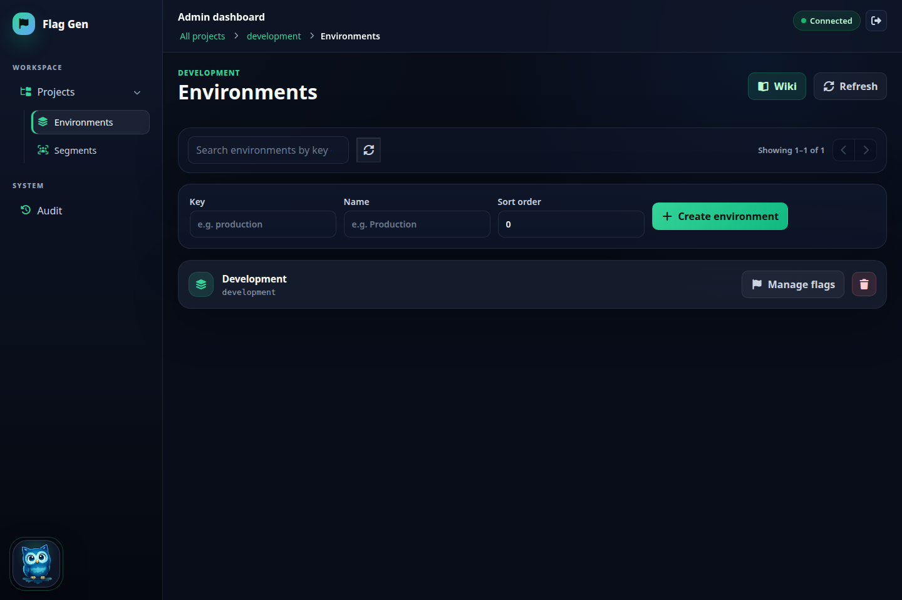
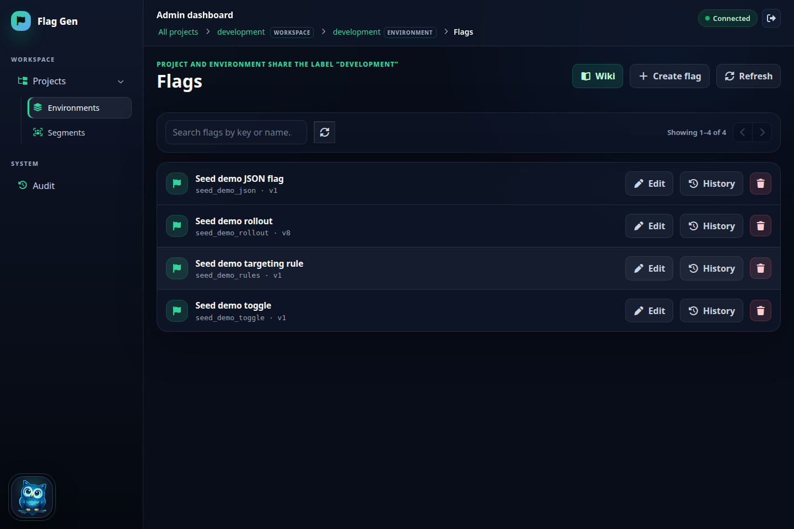
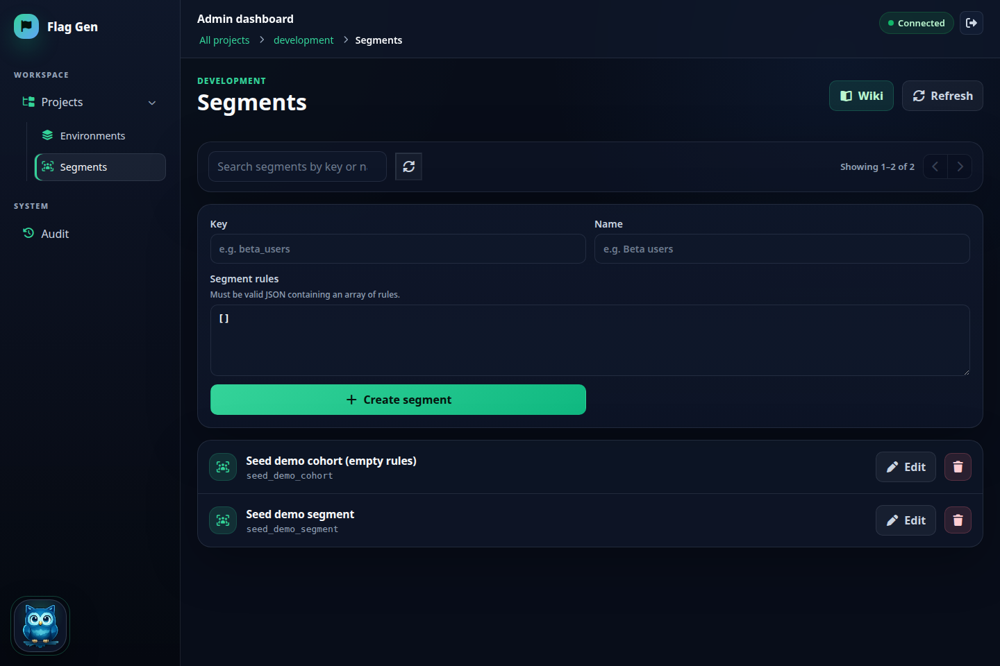
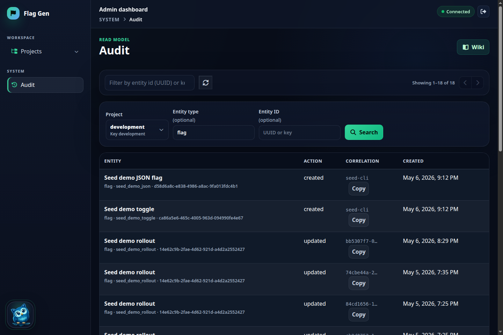

# Flag Gen

Self-hosted feature flag management: controlled rollouts, fast rollback, deterministic evaluation, and operationally safe degraded reads.

Built with a Go API, MySQL, Redis-backed cache, RabbitMQ outbox/broadcast, file snapshots, a Go SDK (`sdk/flagclient`), and an Angular admin dashboard.

**Technical documentation lives in [`docs/`](docs/README.md)** — **guide** (use & integrate) and **assessment** (specs). This file is the entry point and table of contents.

---

## Get running locally

```bash
mysql -h127.0.0.1 -uroot -proot \
  -e "CREATE DATABASE IF NOT EXISTS flag_gen CHARACTER SET utf8mb4 COLLATE utf8mb4_unicode_ci;"
cp .env.example .env
make migrate && make seed && make dev
```

| URL | Purpose |
|-----|---------|
| `http://localhost:6124/app/` | Dashboard |
| `http://localhost:6123/health` | API health |
| `http://localhost:6123/v1/system/status` | DB lifecycle |

Demo admin (when `users` table was empty at migrate): `admin@local` / `admin`.  
Full setup, env vars, WebSocket, and curl examples: **[docs/guide/quickstart.md](docs/guide/quickstart.md)**.

---

## Documentation map

### What — product & behavior

| Question | Read |
|----------|------|
| What is flag-gen and what does it provide? | [docs/assessment/features.md](docs/assessment/features.md) |
| What is a feature flag (concept)? | [docs/guide/concepts/feature-flags_id.md](docs/guide/concepts/feature-flags_id.md) (ID) · [docs/guide/concepts/feature-flags.md](docs/guide/concepts/feature-flags.md) (EN) |
| How do definitions, evaluate, cache, and broadcast fit together? | **[docs/guide/how-it-works.md](docs/guide/how-it-works.md)** |
| API shapes & status codes | [docs/assessment/api-contract.md](docs/assessment/api-contract.md) · [docs/api/openapi.yaml](docs/api/openapi.yaml) |

### Who — audience

| You are… | Start here |
|----------|------------|
| Backend / Go service owner | [docs/guide/sdk/sdk-flagclient_id.md](docs/guide/sdk/sdk-flagclient_id.md) · [examples/golang-service/](examples/golang-service/) |
| Frontend / mobile developer | [examples/angular-client/](examples/angular-client/) |
| Dashboard / product operator | [docs/guide/quickstart.md](docs/guide/quickstart.md) + run `make dev` |
| On-call / SRE | [docs/guide/metrics.md](docs/guide/metrics.md) · [docs/guide/how-it-works.md](docs/guide/how-it-works.md) |

### Where — code & infrastructure

| Location | Purpose |
|----------|---------|
| `cmd/app` | Main API + dashboard proxy |
| `application/` | Usecases & jobs |
| `domain/` | Entities & ports |
| `delivery/http/` | Gin handlers & router |
| `infrastructure/` | MySQL, Redis, RabbitMQ, snapshots |
| `sdk/flagclient/` | Go client & ServerSDK |
| `web/` | Angular admin (`/app/`) |
| `docs/` | **[Documentation index](docs/README.md)** |
| `examples/` | [Integration examples](examples/README.md) |

Local dependencies (see `.env.example`): MySQL `127.0.0.1:3306`, Redis `6379`, RabbitMQ `5672`.

### When — use flags & which path

| Situation | Guidance |
|-----------|----------|
| Feature flag vs permanent config | [docs/guide/concepts/feature-flags_id.md](docs/guide/concepts/feature-flags_id.md) |
| Gradual rollout, rollback, segmentation | Same wiki — *Kapan feature flag diperlukan* |
| Sync flag definitions to a service | WebSocket broadcast — [docs/guide/how-it-works.md](docs/guide/how-it-works.md) |
| Per-user targeting / rollout | `POST .../flags/evaluate` — [docs/assessment/evaluation-semantics.md](docs/assessment/evaluation-semantics.md) |
| Live updates after dashboard edit | Enable outbox + broadcast — [docs/guide/quickstart.md](docs/guide/quickstart.md) |
| Empty DB or pending migrations | [docs/assessment/database-lifecycle.md](docs/assessment/database-lifecycle.md) |

**Best practices:** naming, cleanup, client-side safety — [docs/guide/concepts/feature-flags_id.md](docs/guide/concepts/feature-flags_id.md#praktik-terbaik); SDK pitfalls — [docs/guide/sdk/sdk-flagclient_id.md](docs/guide/sdk/sdk-flagclient_id.md#15-anti-pattern-hindari).

### How — integrate & operate

| Task | Document |
|------|----------|
| Local quickstart & env | [docs/guide/quickstart.md](docs/guide/quickstart.md) |
| End-to-end runtime explanation | [docs/guide/how-it-works.md](docs/guide/how-it-works.md) |
| Go SDK (WebSocket, evaluate, auth) | [docs/guide/sdk/sdk-flagclient_id.md](docs/guide/sdk/sdk-flagclient_id.md) |
| Sample apps | [examples/README.md](examples/README.md) |
| Metrics & alerts | [docs/guide/metrics.md](docs/guide/metrics.md) |
| TLS / production transport | [docs/guide/transport-security.md](docs/guide/transport-security.md) |
| Implementation checklist | [docs/guide/implementation-status.md](docs/guide/implementation-status.md) |

---

## Screenshots

Local seed scope `development` / `development` (human-readable keys), demo user `admin@local`. API paths use the **Project ID (UUID)** from the dashboard Projects list, not the project key.

| View | |
|------|--|
| Login |  |
| Projects |  |
| Environments |  |
| Flags |  |
| Segments |  |
| Audit |  |

---

## Webhooks (optional)

```bash
WEBHOOK_WORKER_ENABLED=true
WEBHOOK_URLS=https://example.internal/flag-events
WEBHOOK_SECRET=change-me
```

Signed delivery headers: `X-Flag-Gen-Event-ID`, `X-Flag-Gen-Event-Type`, `X-Flag-Gen-Signature`. See [docs/guide/metrics.md](docs/guide/metrics.md) for webhook metrics.

---

## Development commands

```bash
make help
make migrate
make seed
make dev          # API :6123 + dashboard :6124
make build
go test ./...
make wire         # after DI provider changes
```

---

## Status

MVP covers flag CRUD, evaluation, dashboard, cache/snapshot resilience, outbox → RabbitMQ → WebSocket broadcast, metrics, and local demo flows. Roadmap items (password sessions, full RBAC parity, advanced experimentation) are tracked in [docs/guide/implementation-status.md](docs/guide/implementation-status.md).
